# To-Do List API

A small REST API for managing a to-do list, where **tasks** are grouped into **categories**.
Built with Java 17, Spring Boot 3, and Oracle.


---

## Repository structure

```
.
├── diagrams/           # Design diagrams (this README)
├── todo-api/           # The Spring Boot REST API
└── todo-api-tests/     # Playwright API test suite (51 automated tests)
```

## Features

- Full **CRUD** for Categories and Tasks.
- 🔒 A Category **can't be deleted** while it still has Tasks.
- Task fields: title (required), description, status (`TODO` / `IN_PROGRESS` / `DONE`), due date (can't be in the past), category (required).
- Task listing supports **filtering** by status and/or category, with **paging**.
- ⚠️ Consistent, structured error responses (validation / not-found / conflict).
- Interactive API docs via **Swagger UI**.

## Tech stack

| Layer | Technology |
|---|---|
| Language | Java 17 |
| Framework | Spring Boot 3 (Web, Data JPA, Validation) |
| Database | Oracle |
| API docs | springdoc-openapi (Swagger UI) |
| Testing | Playwright (TypeScript) — API testing mode |

## Getting started

1. **Run the API** → see [`todo-api/README.md`](./todo-api/README.md) for the Oracle setup and how to start the server.
2. **Try it out** → open `http://localhost:8080/swagger-ui.html` once it's running.
3. **Run the tests** → see [`todo-api-tests/README.md`](./todo-api-tests/README.md) for setup, commands, and what all 51 test cases cover.

---

## Enhancements

Five change requests were scoped and designed on top of the base API (see [`enhancements/`](./enhancements/) for the full change requests, technical designs, and test cases). **Three are implemented**, two remain design-only:

| CR | Enhancement | Status |
|---|---|---|
| CR-001 | Optimistic Locking (`@Version` on Task, `409` on stale updates) | ✅ Implemented |
| CR-002 | API Idempotency (`Idempotency-Key` header on task creation) | ✅ Implemented |
| CR-003 | Scheduled Overdue-Task Detection | 📝 Designed, not implemented |
| CR-004 | Audit Trail | 📝 Designed, not implemented |
| CR-005 | AI-Assisted Task Breakdown (`POST /api/tasks/ai-breakdown`) | ✅ Implemented |

---

## Diagrams

A visual tour of the system, in order — what a client can do, how one request flows through it, how the data is shaped, and how the code is organized.

### 1️⃣ Use Case Diagram
*Every action an API client can perform, and the error each one can return.*
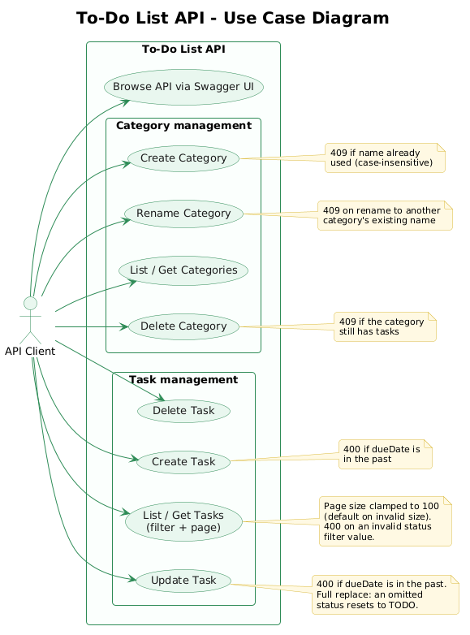

### 2️⃣ Activity Diagram — Create Task
*Step by step: validation → category lookup → default status → save → response.*
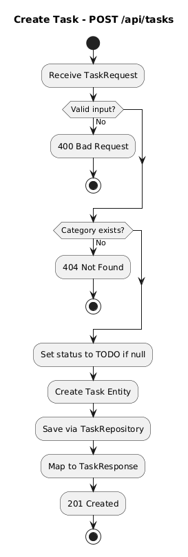

### 3️⃣ ER Diagram
*How `CATEGORY` and `TASK` relate in Oracle — one category, many tasks.*
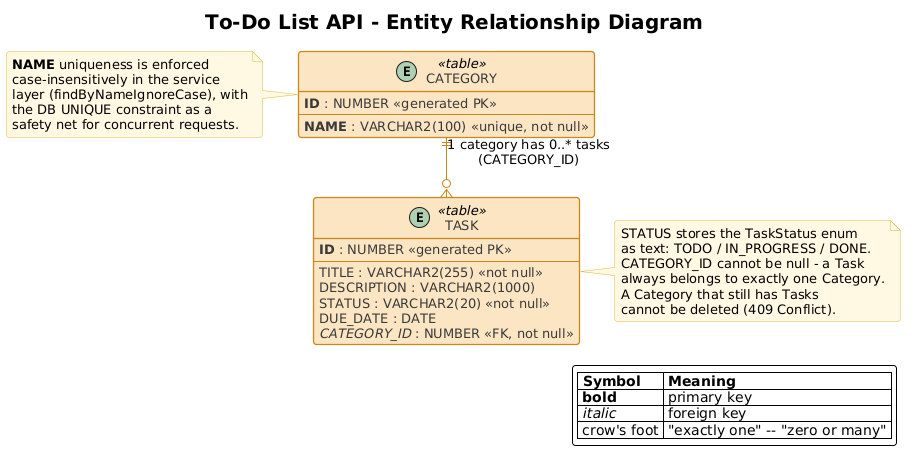

### 4️⃣ Class Diagram
*The full picture: controllers → services → repositories → entities, plus error handling.*
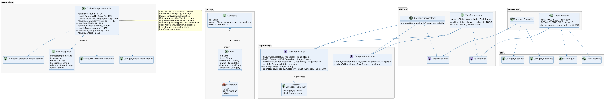

<details>
<summary><strong>Class diagram, by layer</strong> (click to expand)</summary>

**Domain model** — entities and their DTOs
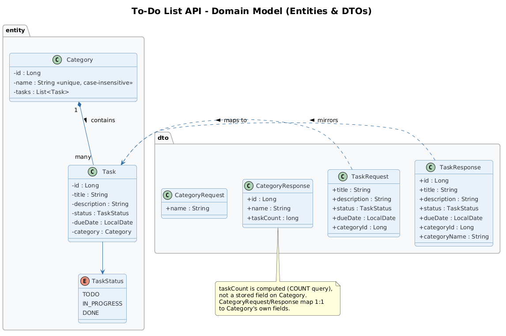

**Data layer** — services and repositories
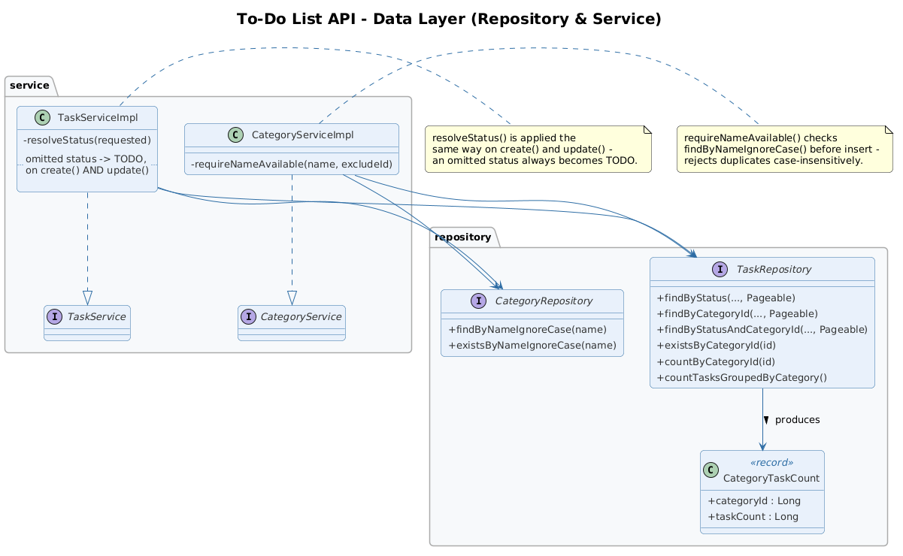

**Web layer** — controllers and centralized error handling
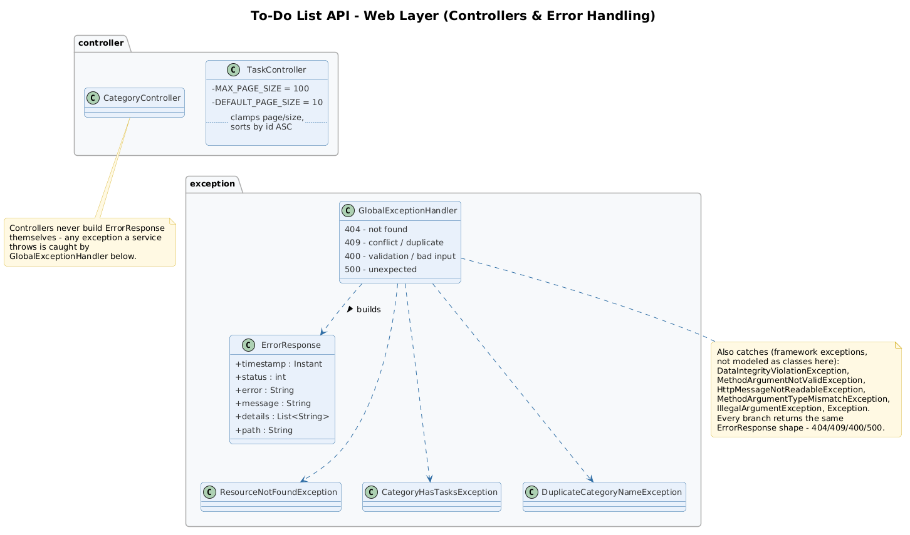

</details>

<details>
<summary><strong>Sequence diagrams</strong> — four key requests end-to-end (click to expand)</summary>

**Create Task** — `POST /api/tasks`
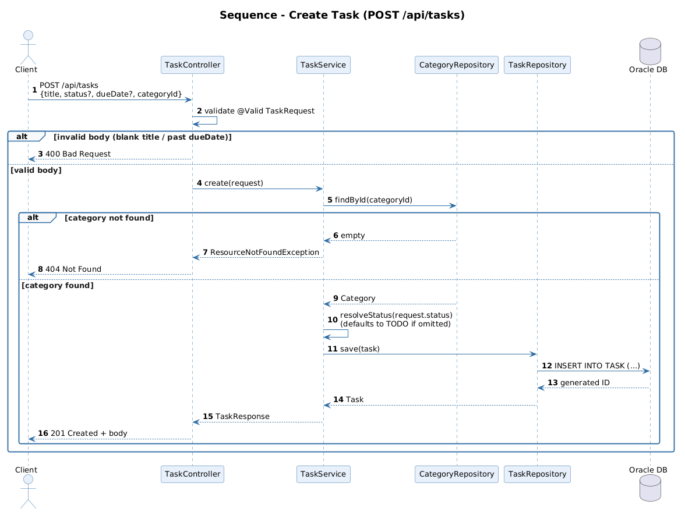

**Create Category, duplicate name rejected** — `POST /api/categories`
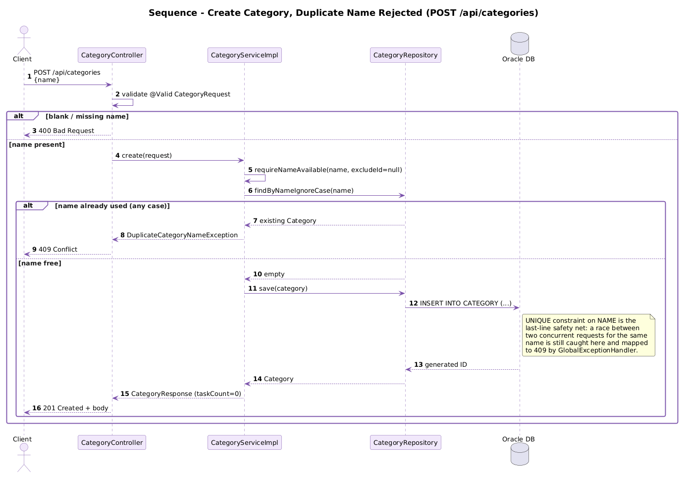

**Delete Category** — `DELETE /api/categories/{id}`
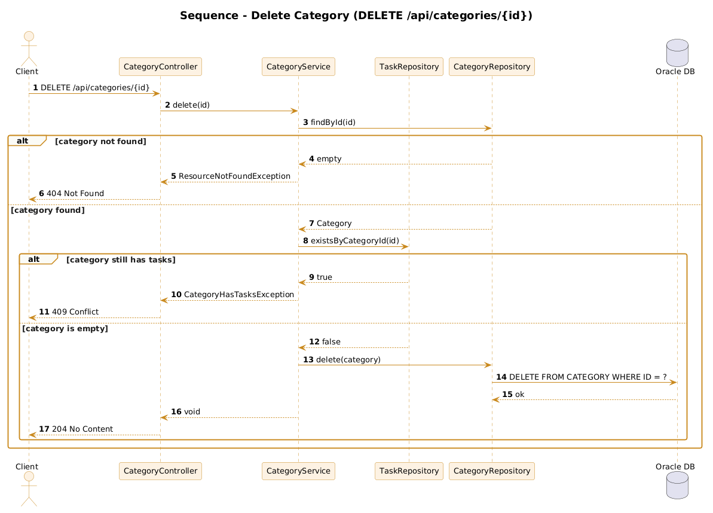

**List Tasks, filtering & paging** — `GET /api/tasks`
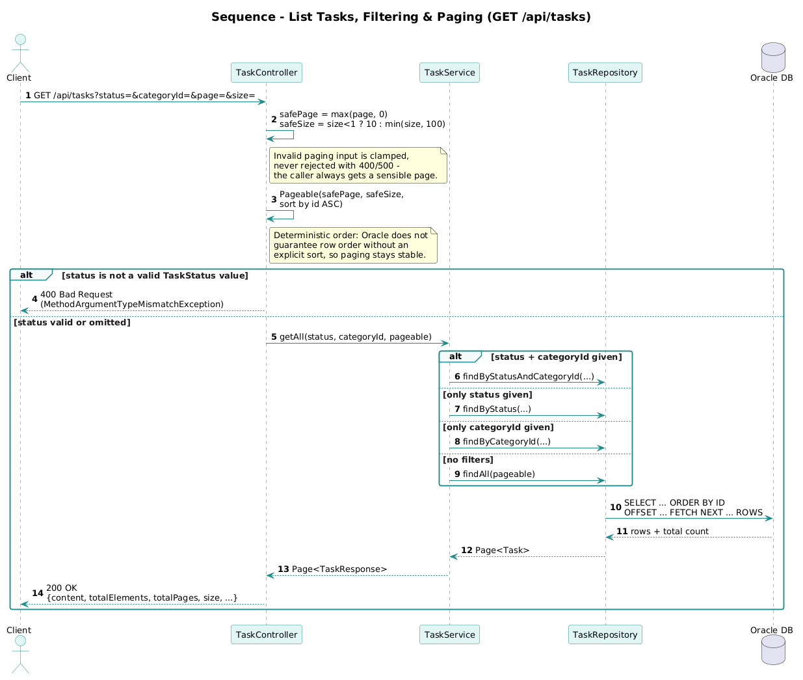

</details>

